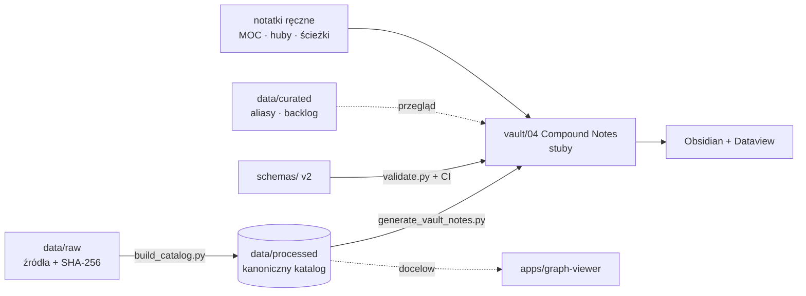

# 💊 Pharma-vault

**Oparta na dowodach, zorientowana na bezpieczeństwo baza wiedzy farmakologicznej** — nootropiki, substancje OUN, peptydy, hormony i farmakologia pokrewna — w postaci kanonicznego katalogu danych, vaultu Obsidian i interaktywnego grafu.

> ⚠️ **Zastrzeżenie:** projekt ma charakter wyłącznie edukacyjny (nauka farmakologii klinicznej i świadomości ryzyka). **Nie jest poradą medyczną i celowo nie zawiera zaleceń dawkowania.** Obecność substancji w katalogu lub sklepie nie jest dowodem skuteczności, czystości, legalności ani bezpieczeństwa.

## 📊 W liczbach

| | |
|---|---|
| 🧪 Substancje w katalogu | **2 351** (18 grup źródłowych → 8 klastrów) |
| 🧬 Z mechanizmem ChEMBL | 661 |
| 🔀 Kolizje aliasów do przeglądu | 51 |
| 🛡️ Huby bezpieczeństwa | 7 |
| 📋 Kandydaci do rozszerzenia | 264 |

## 🏗️ Architektura



Zasada: **jedno źródło prawdy, reszta to widoki generowane** — zob. [ADR-0001](docs/adr/0001-canonical-source-of-truth.md).

## 📂 Struktura

```
Pharma-vault/
├── apps/graph-viewer/        🕸️ interaktywny graf HTML (Canvas)
├── data/
│   ├── raw/                  📥 źródła (JS pharmapedia, PDF sklepu) + SHA-256
│   ├── processed/            🗄️ kanoniczny katalog (CSV/JSON, manifest)
│   └── curated/              ✍️ aliasy, backlog rozszerzeń, produkty sklepu
├── docs/
│   ├── architecture/         🏛️ plan wdrożenia, rejestr decyzji, backend, wizja
│   ├── adr/                  📐 Architecture Decision Records
│   └── research/             🔬 analizy źródeł i projektu schematu
├── schemas/                  📏 JSON Schema frontmatteru v2
├── scripts/                  ⚙️ build → generate → validate
├── tests/                    ✅ pytest
├── vault/                    🧠 vault Obsidian (otwórz ten folder)
│   ├── 00 Home/
│   ├── 01 Maps of Content/
│   ├── 02 Concepts/
│   ├── 03 Pathways/          (+ CYP450 Pathways.canvas)
│   ├── 04 Compound Notes/    (generowane, 8 podfolderów-klastrów)
│   ├── 05 Compound Clusters/
│   ├── 06 Safety Hubs/
│   └── 90 Templates/
└── Resources/                📦 archiwum v1 — analiza „Biohacking Bible”
```

## 🚀 Szybki start

```bash
pip install -r requirements.txt
make all        # catalog → vault → validate → test
make xlsx       # opcjonalnie: substances.xlsx
```

Obsidian: **Open folder as vault → `vault/`**, włącz wtyczkę **Dataview**. Zacznij od `00 Home/Home.md`.

## 🔁 Workflow kuracji

`stub` → `candidate` → `expanded` → `verified` (→ `needs-update`)

1. Wybierz notatkę z `01 Maps of Content/Review Queue.md`.
2. Uzupełnij frontmatter wg `90 Templates/Compound Note Example.md` (poziom dowodów A–X — `02 Concepts/Evidence Tiers.md`).
3. Zmień `review-status` — od tej chwili generator **nie nadpisze** notatki.
4. `make validate` (CI robi to samo przy każdym pushu).

## 🧭 Proweniencja

| Element | Pochodzenie |
|---|---|
| Katalog 2 351 substancji | Deterministyczny parse `data/raw/pharmapedia-source/CompoundCatalog.source.js.txt` |
| Notatki-stuby | Generowane z katalogu (**nie** są przeglądem klinicznym) |
| Huby, ścieżki, koncepcje, szablony | Napisane ręcznie w v3 na podstawie projektu z wątku roboczego |
| `docs/research`, `docs/architecture` | Eksport wątku roboczego z nagłówkiem proweniencji |
| `Resources/` | Oryginalna zawartość repo v1 (commit `6a43d7d`) |

## 📦 Resources

Folder [`Resources/`](Resources/README.md) zawiera całą wcześniejszą zawartość repozytorium — krytyczną analizę „Biohacking Bible” (przegląd, tabela selekcyjna, zakres pominięć, pełna tabela) — przeniesioną bez zmian treści.
