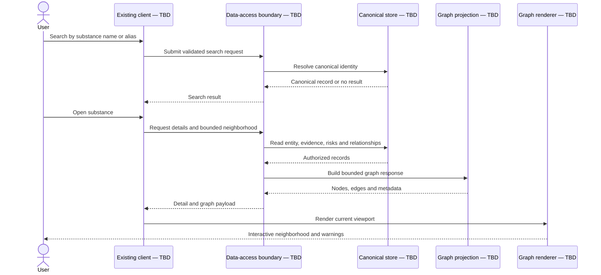
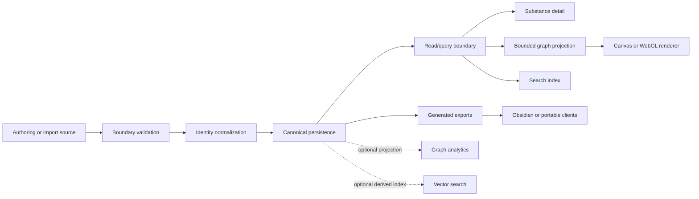

# Project improvement & implementation plan

> **Status (2026-09-26, v3):** repozytorium zostało utworzone jako `mmlsk/Pharma-vault`, więc bramki **DISC-01** (dostęp do repo) i **DISC-02** (baseline commit) są spełnione. Zrealizowano: kanoniczny katalog w `data/processed/`, generator notatek, schemat JSON v2, walidację i CI (`Makefile`, `.github/workflows/ci.yml`). Backend/API pozostaje odroczony zgodnie z [ADR-0001](../adr/0001-canonical-source-of-truth.md). Poniższy tekst to oryginalny plan z wątku.

> Źródło: wątek projektu Pharma-vault (tura 20), wyeksportowany 2026-09-26. Treść zachowana w oryginalnym brzmieniu; numerowane odwołania typu [1] odnoszą się do źródeł przywołanych w oryginalnym wątku (materiały w `data/raw/`).

A repository-specific implementation plan cannot be completed honestly yet because **no repository snapshot, branch/commit, current schema, or completed capability description is available in this conversation**. The safest deliverable is therefore a gated development plan: Phase 0 verifies the codebase and requirements; later phases remain conditional until those gates pass.

No code or repository files are modified below.

# Project Improvement Plan

## Planning status

| Item | Status | Consequence |
|---|---|---|
| Repository access | Not available | Files, frameworks, APIs, dependencies, tests, and conventions cannot be verified |
| Target branch/commit | Not specified | Findings could not be tied to an immutable baseline |
| Requested capability | Placeholder remains: `[DESCRIBE THE FEATURE OR CHANGE]` | Primary user flow and acceptance criteria are undefined |
| Current deployment | Unknown | Infrastructure and rollout steps cannot be selected |
| Current data model | Unknown | Tables, migrations, indexes, and access policies cannot be specified safely |
| Authentication model | Unknown | Authorization and row-level security cannot be designed |
| Performance baseline | Unknown | Canvas/WebGL/database changes cannot be justified by measurements |
| Existing project artifacts | Discussed in the thread, but not inspectable here | Prior architectural ideas are recommendations, not repository facts |

The previous discussion established intended scale and direction: a substance knowledge system expected to grow to several thousand entries, accumulate many attributes and relationships, and support multiple visualization tools. It did **not** establish what is already implemented in the repository.

***

# Repository findings

## Verified facts

There are currently **no verified repository findings**. No source tree, manifest, schema, migration directory, test configuration, deployment configuration, or generated artifact was supplied for inspection.

| Area | Existing implementation | Relevant files | Impact on requested change |
|---|---|---|---|
| Repository structure | Not verified | Not available | Change boundaries cannot be identified |
| Frontend | Not verified | Not available | Cannot confirm React, TypeScript, Canvas, SVG, or visualization libraries |
| Backend | Not verified | Not available | Cannot confirm whether an API or server exists |
| Database | Not verified | Not available | Cannot confirm SQLite, PostgreSQL, Supabase, Neo4j, or file-based storage |
| Domain model | Not verified | Not available | Cannot map substances, aliases, claims, evidence, risks, or relationships |
| Authentication | Not verified | Not available | Authorization requirements cannot be defined |
| Data ingestion | Not verified | Not available | Cannot identify import, validation, deduplication, or export behavior |
| Visualization | Not verified | Not available | Cannot confirm rendering technology or measured limits |
| Tests | Not verified | Not available | Existing test conventions and coverage are unknown |
| CI/CD | Not verified | Not available | Quality gates and deployment workflow cannot be preserved |
| Observability | Not verified | Not available | Existing logging, metrics, and error reporting are unknown |
| Obsidian integration | Not verified | Not available | Cannot determine whether Markdown is canonical, generated, or manually maintained |

## Thread requirements

These are requirements or intentions expressed in the discussion, not repository facts:

- The library may grow to several thousand substances.
- Individual substances may gain many more attributes.
- The platform should serve multiple visualization clients.
- The architecture should preserve room for expansion.
- Graph exploration and safety relationships are major use cases.
- Obsidian, HTML, Canvas, PostgreSQL, SQLite, pgvector, Neo4j, Cytoscape.js, Sigma.js, Plotly.js, Polars, and DuckDB have been considered.
- The working architectural preference is a canonical structured store with generated views and exports.
- Premature microservices, streaming infrastructure, distributed computing, and unnecessary database duplication should be avoided.

## Smallest assumptions

Only the following provisional assumptions are safe enough for planning:

1. The project needs at least one persistent representation of substances and relationships.
2. It needs at least one interactive client for search and graph exploration.
3. Scientific claims need source provenance and review status.
4. User-supplied or imported data is untrusted and must be validated.
5. The first release can remain a modular monolith unless the repository proves otherwise.
6. The graph renderer should receive bounded subgraphs rather than the entire dataset by default.
7. PostgreSQL, Neo4j, Supabase, React, and Canvas are **candidate technologies**, not confirmed dependencies.

## Open blockers

- The feature request is not filled in.
- The repository cannot be inspected.
- It is unclear whether v3 exists as source code, static HTML, an Obsidian vault, or a generated archive.
- The canonical source of truth is unknown.
- It is unclear whether the application is single-user, collaborative, public read-only, or administratively curated.
- No performance target or representative dataset is supplied.
- No deployment provider or data-sensitivity classification is defined.

***

# Recommended approach

## Immediate recommendation

Do **not** begin with a database migration, renderer rewrite, Neo4j introduction, or repository restructuring. Begin with a short repository-discovery and capability-definition phase that produces:

- An immutable baseline commit
- A verified component map
- A data-ownership map
- The primary user flow
- Measurable acceptance criteria
- A performance baseline
- One architecture decision record
- A vertical-slice implementation plan tied to actual files

After discovery, implement the smallest end-to-end read-only capability using the existing stack. Introduce new infrastructure only when the current stack cannot meet a confirmed requirement.

## Candidate target shape

The following is a **provisional target**, not a verified description of the repository:

```text
Editorial/import sources
        │
        ▼
Validation and normalization boundary
        │
        ▼
Canonical structured store
        │
        ├── Search/read API
        ├── Graph-neighborhood API
        ├── Export process
        └── Optional semantic index
                │
                ▼
        Existing application client
                │
                ├── Record/detail view
                ├── Graph exploration
                ├── Safety views
                └── Quantitative visualizations
```

The first implementation should remain a **modular monolith**:

- One canonical database
- One application backend, if a backend already exists or is required
- One frontend application
- One background import command or process, only if imports are required
- No event broker
- No distributed processing
- No separate graph database
- No separate vector database
- No two-way synchronization between Obsidian and the application

## Why this is safest

- It minimizes moving parts.
- It prevents data divergence among Markdown, HTML, relational, graph, and vector representations.
- It allows graph and vector capabilities to be added as derived projections.
- It preserves the existing architecture until repository inspection demonstrates a specific limitation.
- It makes correctness, provenance, authorization, and rollback easier to test.
- It supports a few thousand substances without introducing infrastructure intended for much larger workloads.
- It separates domain data from rendering technology, allowing Canvas, WebGL, or other clients to consume the same contract.

## Alternatives considered

| Alternative | Decision | Reason |
|---|---|---|
| Keep Markdown as the only database | Conditional rejection | May remain suitable for single-user authoring, but cannot be approved before consistency, query, and concurrency requirements are known |
| Replace everything with PostgreSQL immediately | Rejected for now | Existing storage and migration cost are unknown |
| Make Neo4j canonical | Rejected initially | Adds operational and synchronization complexity before graph-query requirements are measured |
| PostgreSQL plus Neo4j plus vector database from day one | Rejected | Three data systems create premature consistency and operational burdens |
| Rewrite SVG views in Canvas immediately | Rejected pending benchmark | Renderer may not be the measured bottleneck; edge count, layout, labels, and unbounded queries may matter more |
| Start with WebGL | Deferred | Appropriate only after representative graph benchmarks establish the need |
| Microservices | Rejected | No independent scaling, ownership, or release requirement has been established |
| Kafka or another event platform | Rejected | No high-volume event stream or asynchronous integration requirement exists |
| PySpark or distributed processing | Rejected | No dataset size or compute profile justifies distributed execution |
| Supabase adoption | Unresolved | Depends on current hosting, authentication, database, and operational preferences |
| Obsidian as canonical and HTML as generated output | Viable for a single-user/local product | Requires validation after repository inspection and collaboration requirements |
| Database as canonical and Obsidian as generated/editorial projection | Provisional preference | Better fit for multiple clients, but must be reconciled with current implementation |

## Decisions requiring confirmation

1. What exact user outcome constitutes the requested capability?
2. What is the current and future canonical source of truth?
3. Is the system local/single-user, shared/private, or public with privileged curators?
4. Is server-side infrastructure acceptable, or must the project remain static/offline?
5. What scale and latency targets must search and graph exploration satisfy?
6. Is Obsidian allowed to write canonical data, or only consume generated notes?
7. Are semantic search and graph analytics release requirements or later enhancements?
8. Which data may be publicly exposed?
9. Must source PDFs or extracted passages be retained?
10. Is Supabase already used?

***

# Delivery roadmap

## Phase 0 — Discovery

**Goal:** replace assumptions with verified repository facts.

### Activities

1. Pin the target branch and commit.
2. Inventory manifests, packages, source directories, generated files, scripts, migrations, tests, and deployment configuration.
3. Run the existing documented setup without changing code.
4. Run lint, typecheck, tests, and production build.
5. Locate the current substance data and determine ownership.
6. Trace one existing record from storage through transformation to rendering.
7. Identify all write paths and export paths.
8. Capture representative record, relationship, and graph sizes.
9. Profile the current graph using representative data.
10. Produce a repository map and dependency diagram.

### Checkpoint M0

Proceed only when:

- The repository builds reproducibly.
- Existing failures are recorded separately from the requested change.
- Canonical data ownership is known.
- The requested capability is expressed as observable user behavior.
- The primary flow is traceable to actual files.

***

## Phase 1 — Requirements

**Goal:** convert the feature placeholder into an acceptance contract.

### Required outputs

- User actors and permissions
- Read and write use cases
- Explicit non-goals
- Data classification
- Performance budget
- Offline requirements
- Import/export requirements
- Failure behavior
- Browser/device support
- Release and rollback expectations

### Suggested measurable criteria

These must be confirmed rather than assumed:

- Maximum records and relationships in canonical storage
- Maximum nodes and edges returned per request
- Search response target
- Graph-neighborhood response target
- Browser interaction target
- Import duration target
- Maximum client bundle size
- Maximum permissible staleness for generated exports

### Checkpoint M1

Requirements are ready when each requested behavior has:

- An actor
- A precondition
- A trigger
- An expected result
- A failure result
- An authorization rule
- A measurable acceptance criterion

***

## Phase 2 — Architecture baseline

**Goal:** preserve existing conventions while defining clear boundaries.

### Decisions

- Canonical storage
- Application boundary
- Domain model ownership
- Validation boundary
- API or local-query contract
- Graph projection strategy
- Obsidian integration direction
- Export formats
- Authentication and authorization placement
- Deployment topology

### Required records

- ADR: canonical source of truth
- ADR: graph rendering strategy
- ADR: graph database decision
- ADR: vector-search decision
- ADR: Obsidian integration
- ADR: deployment and backup model

### Checkpoint M2

No implementation begins until:

- Every new dependency has a documented requirement.
- Every derived store has a rebuild strategy.
- There is only one canonical writer unless concurrency explicitly requires more.
- Data authority and synchronization direction are unambiguous.
- Rollback can restore the previous read path.

***

## Phase 3 — Domain contracts

**Goal:** establish stable identities and boundaries before expanding the UI.

### Required contracts

- Canonical entity identifier
- Alias normalization
- Entity-type vocabulary
- Relationship-type vocabulary
- Evidence classification
- Source citation model
- Review status
- Risk/safety association model
- Import validation
- Export schema
- Versioning policy

### Rules

- Do not encode aliases as independent substances.
- Do not infer evidence relationships from vector similarity.
- Do not treat a vendor listing as proof of efficacy.
- Do not make visualization layout coordinates canonical scientific data.
- Do not store every attribute in an unrestricted metadata object without validation.
- Preserve unknown, disputed, and not-applicable as distinct states if the domain requires them.

### Checkpoint M3

A small representative dataset must pass:

- Identity validation
- Alias collision detection
- Relationship validation
- Source linkage validation
- Round-trip export validation
- Deletion and rollback tests

***

## Phase 4 — Vertical slice

**Goal:** deliver one complete, low-risk feature through every layer.

Recommended first slice:

> Search for one substance by canonical name or alias, open its detail view, retrieve a bounded one-hop neighborhood, render that neighborhood, and show associated sources and safety warnings.

This slice exercises:

- Identity
- Aliases
- Search
- Data access
- Validation
- Graph projection
- Rendering
- Empty states
- Error handling
- Source provenance
- Safety information
- Authorization, if editing exists
- Tests and observability

### Checkpoint M4

The slice is accepted only if:

- Canonical and alias searches resolve to the same entity.
- The graph request is bounded.
- Unknown relationships are not fabricated.
- Source and warning data retain provenance.
- Unauthorized writes are rejected.
- Loading, empty, invalid, and failure states are usable.
- Representative performance targets pass.

***

## Phase 5 — Scale hardening

**Goal:** demonstrate that the selected architecture supports the expected medium-sized dataset.

### Backend work

- Query-plan inspection
- Index verification
- Pagination or cursoring
- Bounded traversal
- Response-size enforcement
- Cached derived projections only if measurements justify them
- Import batching and transaction boundaries
- Duplicate and referential-integrity reporting

### Frontend work

- Viewport culling
- Semantic zoom
- Label budgets
- Edge filtering
- Cluster-first display
- Web Worker layout, if needed
- Stable layout caching, if appropriate
- Rendering benchmark for SVG, Canvas, and WebGL candidates

### Checkpoint M5

Renderer or database changes require benchmark evidence showing:

- Current failure mode
- Representative dataset
- Test device/browser
- Before-and-after measurements
- Memory impact
- Interaction impact
- Complexity cost

***

## Phase 6 — Expanded visualization

Add visualizations one use case at a time:

1. Network neighborhood
2. Evidence heatmap
3. Interaction/risk matrix
4. Pathway diagram
5. Timeline
6. Scatter or bubble evidence-risk view
7. Hierarchical class view
8. Sankey/alluvial mechanism-to-risk flow
9. UpSet view for overlapping mechanisms or risks
10. Architecture and curation workflow diagrams

Each visualization must have:

- A named analytical question
- A documented input contract
- A maximum data volume
- Accessibility fallback
- Export behavior
- A test dataset
- A reason it is not duplicating an existing view

***

## Phase 7 — Optional intelligence

Semantic retrieval should come only after canonical identity and source provenance are stable.

### Safe progression

1. Generate embeddings for approved text fields.
2. Store model name, model version, source record, and generation timestamp.
3. Implement read-only similarity search.
4. Present results as suggestions.
5. Require human confirmation before creating relationships.
6. Evaluate retrieval quality using a fixed test set.
7. Consider a dedicated vector store only after pgvector or the existing solution demonstrates a measured limitation.

Graph analytics should follow the same rule: create a rebuildable projection only after concrete traversal or algorithm use cases are accepted.

***

## Phase 8 — Release hardening

- Backup and restore rehearsal
- Migration rehearsal
- Security review
- Dependency audit
- Observability verification
- Accessibility review
- Browser/device testing
- Documentation
- Data export verification
- Rollback rehearsal
- Operational ownership
- Post-release monitoring window

***

# Change map

## Provisional sequence

The following sequence is a **candidate read-only user flow derived from the thread**, not a verified representation of the repository.



## Provisional graph



## Data flow

1. A curator or import process submits candidate data.
2. The system validates structure, allowed values, identity fields, and source references at the boundary.
3. Identity normalization resolves aliases and prevents obvious duplicates.
4. Accepted data is written to the canonical store in one transaction where practical.
5. Read clients access data through the existing data-access convention discovered in Phase 0.
6. Detail requests return only the requested record and authorized related information.
7. Graph requests apply depth, node-count, edge-count, and relationship-type limits.
8. The projection converts domain records into renderer-neutral nodes and edges.
9. Canvas or WebGL renders only the active view; it does not become a source of truth.
10. Obsidian, SQLite, JSON, CSV, or static HTML outputs are generated from canonical data.
11. Optional vector and graph stores are rebuildable projections and must not independently own scientific facts.

***

# Data model plan

## Status

A physical schema cannot be specified until the current schema and requested capability are known. The table below is therefore a **logical-domain proposal**, not a set of approved database tables or field names.

| Logical entity | Purpose | Candidate information | Required constraints | Relationships | Candidate access patterns | Access-control requirement |
|---|---|---|---|---|---|---|
| Substance identity | Stable identity for a substance or product | Canonical label, identity type, status | Stable identifier; canonical label rules | Aliases, relationships, claims | Exact lookup, prefix search, filtered listing | Public/read role TBD; curator writes only |
| Alias | Resolve synonyms, codes, brands and variants | Alias value, alias type, locale | Normalized uniqueness within defined scope | One canonical identity | Case-normalized lookup | Same visibility as parent identity |
| Relationship | Typed edge between entities | Subject, predicate, object, status | Valid endpoints; approved predicate; duplicate rule | Two entities; optional evidence | Neighborhood and predicate filtering | Writes restricted to approved curator workflow |
| Claim | Evidence-bearing assertion | Statement or structured value, confidence, review status | Must identify subject; provenance requirement TBD | Entity and sources | Entity claims, status filter | Draft versus published visibility TBD |
| Source | Provenance record | Citation identifier, source type, publication metadata | Stable source key where available | Claims and reviews | Citation lookup | Public metadata; attachment permissions TBD |
| Safety association | Links entities to controlled risk domains | Risk domain, evidence status, qualification | Controlled vocabulary; provenance rules | Substance, risk domain, claims | Safety filtering and warnings | Editorial writes restricted |
| Review event | Audit history | Action, actor, timestamp, reason | Append-only semantics if required | Reviewed record | Audit display and investigation | Restricted to authorized reviewers |
| Saved view | Curated graph/query configuration | Filters, layout reference, visibility | Owner and scope rules | Entities or query definition | Load/share view | Owner/team/public policy TBD |
| Embedding record | Rebuildable semantic index metadata | Source reference, model/version, vector | Unique per source/model/version | Entity, claim, or passage | Similarity search | Must not expose restricted source text |

## Physical design rules

If a relational database is confirmed:

- Stable identity and frequently filtered fields should use normal typed columns.
- Sparse, unsettled metadata may use a constrained document field.
- Foreign keys should protect required relationships.
- Enumerations should be implemented according to existing repository conventions.
- Search and graph indexes should be based on observed queries.
- Vector indexes should not be added until the embedding model and retrieval workload are fixed.
- Layout coordinates should live in saved-view or projection data, not canonical pharmacology records.

## Migration order

No migration should be written before the repository inventory. The conditional order is:

1. Add backward-compatible schema structures.
2. Add constraints that tolerate the current data during backfill.
3. Backfill stable identities.
4. Normalize aliases.
5. Backfill relationships and source provenance.
6. Validate duplicates and orphaned references.
7. Add indexes based on confirmed queries.
8. Switch reads behind a feature flag or equivalent existing mechanism.
9. Switch writes only after read parity is demonstrated.
10. Tighten constraints.
11. Retire old structures in a later release.

## Backfill requirements

The discovery phase must determine:

- Existing canonical identifiers
- Duplicate substances
- Alias collisions
- Product-versus-molecule ambiguity
- Missing source links
- Free-text relationship labels
- Invalid frontmatter
- Orphan links
- Conflicting evidence classifications
- Records without review status

Backfill must be deterministic and rerunnable. Ambiguous identity merges require a review queue rather than automatic resolution.

## Rollback

A safe rollout should prefer additive migrations:

- Preserve the old read path during verification.
- Do not delete or rename existing canonical fields in the same release that introduces replacements.
- Record mappings from legacy identifiers to new identifiers.
- Ensure generated projections can be discarded and rebuilt.
- Back up canonical data before migration.
- Verify restoration in a non-production environment.
- Separate application rollback from irreversible data cleanup.
- Delay destructive cleanup until at least one stable release after cutover.

## Seeds and fixtures

Use only:

- A minimal synthetic structural fixture that contains no invented scientific claims
- A small, approved, real-data fixture from existing repository records
- Alias collision cases
- Unknown and disputed values
- Missing optional values
- Cyclic graph relationships
- High-degree nodes
- Unauthorized write attempts
- Oversized graph requests
- Deleted or superseded sources

## Retention and deletion

Unresolved questions include:

- Whether scientific records may be hard-deleted
- Whether review history must be retained
- Whether imported source passages have copyright restrictions
- Whether user-created annotations are personal data
- Whether attachments and embeddings must be deleted together
- Whether deleted canonical records remain as tombstones to protect stable identifiers

The safest provisional policy is soft deletion or status-based retirement for canonical entities, with hard deletion reserved for legally required or erroneous sensitive content. This requires owner confirmation.

## Supabase RLS

Supabase usage is not verified, so no concrete policy names or SQL should be invented.

If Supabase is confirmed, minimum policy behavior should include:

- Public or authenticated readers can select only published records permitted by visibility rules.
- Curators can create and update draft domain records.
- Reviewers can change publication or verification status.
- Users can access only their private saved views and annotations unless explicitly shared.
- Service-role operations remain server-side.
- Client code never receives service credentials.
- Audit records cannot be changed by ordinary application roles.
- Policies apply to join tables and storage objects, not only top-level records.
- Authorization is verified with database-level tests using each application role.

***

# Execution backlog

Estimates are provisional engineering days, not commitments. File paths remain **TBD until repository inspection** to avoid inventing repository structure.

| ID | Task | Type | Priority | Est. | Dependencies | Files | Acceptance criteria | Test / validation | Risk |
|---|---|---|---|---:|---|---|---|---|---|
| DISC-01 | Pin repository baseline | Architecture | P0 | 0.5 | None | Existing repository metadata, TBD | Branch and commit recorded; working tree state known | Reproduce checkout | Low |
| DISC-02 | Inventory repository structure | Architecture | P0 | 1 | DISC-01 | Existing manifests and source tree, TBD | Verified map of apps, packages, scripts, tests and deployment assets | Peer review against repository | Low |
| DISC-03 | Reproduce current build | Testing | P0 | 1 | DISC-02 | Existing build configuration, TBD | Setup, lint, tests, typecheck and build outcomes recorded | Clean-environment run | Medium |
| DISC-04 | Trace current data ownership | Architecture | P0 | 1 | DISC-02 | Existing data and access files, TBD | Canonical source and all write/export paths documented | Trace one record end to end | High |
| DISC-05 | Profile current graph | Testing | P0 | 1 | DISC-03, representative data | Existing visualization files, TBD | Node, edge, layout, frame, memory and interaction baseline captured | Repeatable benchmark | Medium |
| REQ-01 | Define requested capability | Architecture | P0 | 1 | Stakeholder answers | Planning document, location TBD | Actor, flow, non-goals and acceptance criteria approved | Requirement review | High |
| REQ-02 | Define scale and performance envelope | Architecture | P0 | 0.5 | DISC-04, DISC-05, REQ-01 | Planning document, TBD | Representative sizes and latency/interaction targets approved | Benchmark scenario review | Medium |
| ARCH-01 | Produce verified component diagram | Architecture | P0 | 1 | DISC-02–05 | Architecture documentation, TBD | Every component maps to actual repository files | Engineering review | Low |
| ARCH-02 | Decide canonical source of truth | Architecture | P0 | 1 | ARCH-01, REQ-01 | ADR location TBD | One canonical writer and projection rules approved | ADR review | High |
| ARCH-03 | Decide graph rendering strategy | Architecture | P1 | 1 | DISC-05, REQ-02 | ADR location TBD | SVG/Canvas/WebGL decision supported by benchmark | Benchmark review | Medium |
| ARCH-04 | Decide graph-database scope | Architecture | P2 | 0.5 | REQ-01, query inventory | ADR location TBD | Adopt/defer decision and trigger documented | Query proof of concept only if needed | Low |
| ARCH-05 | Decide vector-search scope | Architecture | P2 | 0.5 | Search requirements | ADR location TBD | Exact-search versus semantic-search boundary approved | Retrieval evaluation plan | Medium |
| DOM-01 | Inventory existing domain vocabulary | Architecture | P0 | 1.5 | DISC-04 | Existing schemas/types, TBD | Existing entities, fields and relationships documented without renaming | Schema-to-code cross-check | Medium |
| DOM-02 | Define canonical identity rules | Architecture | P0 | 1.5 | DOM-01 | Domain docs/types, TBD | Canonical, alias, product, mixture and combination rules approved | Collision test cases | High |
| DOM-03 | Define relationship contract | Architecture | P0 | 1 | DOM-01 | Domain docs/types, TBD | Allowed endpoints, direction and evidence rules approved | Contract examples reviewed | High |
| DOM-04 | Define provenance contract | Security | P0 | 1 | DOM-01 | Domain docs/types, TBD | Claims can be traced to approved source representations | Orphan-source validation | High |
| SEC-01 | Map actors and permissions | Security | P0 | 1 | REQ-01, DISC-04 | Existing auth configuration, TBD | Read/write/publish/delete matrix approved | Threat-model review | High |
| DB-01 | Design additive migration | Database | P1 | 2 | ARCH-02, DOM-02–04, SEC-01 | Existing migration location, TBD | Forward and rollback behavior reviewed; no destructive cutover | Migration dry run | High |
| DB-02 | Build data-quality audit | Database | P1 | 2 | DOM-02–04 | Existing scripts location, TBD | Reports duplicates, invalid aliases, orphans and unknown vocabularies | Golden fixture test | Medium |
| DB-03 | Implement deterministic backfill | Database | P1 | 2–4 | DB-01, DB-02 | Existing migration/script locations, TBD | Rerun produces identical result; ambiguities quarantined | Two-run idempotency test | High |
| DB-04 | Add query-driven indexes | Database | P1 | 1 | Read queries implemented | Existing migration location, TBD | Representative queries meet approved target | Query-plan test | Medium |
| BE-01 | Define read contract | Backend | P0 | 1 | ARCH-01, DOM-02–04 | Existing API/data-access files, TBD | Existing conventions preserved; payload limits explicit | Contract test | Medium |
| BE-02 | Implement canonical/alias search | Backend | P1 | 1–2 | BE-01, database readiness | Existing backend files, TBD | Canonical name and alias resolve consistently | Unit and integration tests | Medium |
| BE-03 | Implement bounded detail query | Backend | P1 | 1–2 | BE-01 | Existing backend files, TBD | Returns permitted detail, provenance and safety data | Integration and authorization tests | Medium |
| BE-04 | Implement bounded graph projection | Backend | P1 | 2 | BE-03, DOM-03 | Existing backend files, TBD | Enforces depth, node, edge and relation limits | Boundary and load tests | High |
| BE-05 | Add input validation | Security | P0 | 1 | BE-01–04 | Existing boundary/schema files, TBD | Malformed, oversized and unsupported requests rejected consistently | Fuzz/boundary tests | Medium |
| FE-01 | Implement search-to-detail flow | Frontend | P1 | 2 | BE-02, BE-03 | Existing frontend files, TBD | Search, alias resolution, loading, empty and error states work | Component and E2E tests | Medium |
| FE-02 | Add renderer-neutral graph adapter | Frontend | P1 | 1 | BE-04 | Existing frontend files, TBD | Domain payload is isolated from rendering implementation | Unit tests with fixed payload | Medium |
| FE-03 | Implement bounded graph view | Frontend | P1 | 2–3 | FE-02, ARCH-03 | Existing visualization files, TBD | Selected node and one-hop view render within target | Interaction and performance test | Medium |
| FE-04 | Add accessibility fallback | Frontend | P1 | 1 | FE-03 | Existing frontend files, TBD | Graph relationships available as navigable text/table | Keyboard and screen-reader review | Medium |
| TEST-01 | Add vertical-slice E2E test | Testing | P0 | 1 | BE-02–04, FE-01–03 | Existing E2E location, TBD | Search → detail → graph → source flow passes | CI E2E execution | Low |
| TEST-02 | Add authorization tests | Testing | P0 | 1 | SEC-01, write behavior | Existing test location, TBD | Each role is allowed and denied as specified | Role matrix suite | High |
| PERF-01 | Create representative benchmark dataset | Testing | P1 | 1 | REQ-02, data rules | Fixture location TBD | Approved scale and topology represented without fabricated scientific claims | Fixture review | Medium |
| PERF-02 | Benchmark queries and renderer | Testing | P1 | 2 | PERF-01, vertical slice | Benchmark location TBD | Repeatable report against approved budget | CI/manual benchmark | Medium |
| OBS-01 | Add structured failure reporting | Observability | P1 | 1 | Existing observability discovered | Existing logging files, TBD | Import, query-limit and projection failures are visible without sensitive payloads | Forced-failure test | Medium |
| DOC-01 | Document domain and data flow | Documentation | P1 | 1 | DOM tasks, vertical slice | Existing docs location, TBD | New contributor can trace record ownership and flow | Documentation review | Low |
| DOC-02 | Document operations and rollback | Documentation | P0 | 1 | DB and DevOps tasks | Existing docs location, TBD | Backup, migration, rollback and projection rebuild documented | Tabletop rollback exercise | Medium |
| DEV-01 | Add migration CI gate | DevOps | P1 | 1 | DB-01 | Existing CI files, TBD | Clean migration and rollback validation run automatically where feasible | CI run | Medium |
| DEV-02 | Create staged release plan | DevOps | P1 | 1 | Vertical slice, DOC-02 | Existing deployment files, TBD | Feature can be enabled and reverted without destructive cleanup | Staging rehearsal | Medium |
| REL-01 | Conduct release readiness review | Architecture | P0 | 0.5 | All critical-path tasks | Release record, TBD | DoD and rollback evidence approved | Cross-functional sign-off | Low |

## Parallel work

After Phase 0:

- `DOM-01` and `SEC-01` can run in parallel once the relevant code is mapped.
- `ARCH-03`, `ARCH-04`, and `ARCH-05` can run in parallel after requirements are stable.
- Frontend shell work can run alongside backend implementation after the read contract is approved.
- Documentation can begin alongside implementation.
- Benchmark fixture preparation can run alongside the vertical slice.
- Observability can run alongside backend work once current conventions are known.

## Critical path

```text
DISC-01
→ DISC-02
→ DISC-03 / DISC-04 / DISC-05
→ REQ-01
→ REQ-02
→ ARCH-01
→ ARCH-02
→ DOM-01
→ DOM-02 / DOM-03 / DOM-04
→ SEC-01
→ DB-01
→ BE-01
→ BE-02 / BE-03
→ BE-04
→ FE-01 / FE-02
→ FE-03
→ TEST-01 / TEST-02
→ PERF-02
→ DOC-02
→ DEV-02
→ REL-01
```

***

# Milestones

| Milestone | Outcome | Exit checkpoint |
|---|---|---|
| M0: Baseline verified | Repository runs and current architecture is mapped | Build evidence and repository findings approved |
| M1: Capability defined | Requested behavior and non-goals are explicit | Acceptance and performance criteria approved |
| M2: Architecture approved | Ownership, boundaries and technology decisions settled | ADRs approved |
| M3: Data contracts stable | Identity, relationships, evidence and safety contracts defined | Representative validation suite passes |
| M4: Vertical slice complete | Search-to-detail-to-graph flow works | Functional, security and E2E tests pass |
| M5: Scale validated | Queries and rendering meet target | Representative benchmark passes |
| M6: Migration ready | Backfill, rollback and release paths proven | Staging rehearsal succeeds |
| M7: Production release | Capability deployed safely | Monitoring window completes without critical regression |
| M8: Optional expansion | Semantic search or graph analytics added only if justified | Separate ADR and acceptance evaluation |

***

# Definition of Done

The change is complete only when all applicable conditions are met.

## Functional

- The agreed primary user behavior works end to end.
- Canonical names and aliases behave according to the approved identity contract.
- Graph requests return only bounded, valid relationships.
- Loading, empty, invalid-input, partial-data, and failure states are covered.
- Exported or generated views preserve canonical identifiers and provenance.

## Authorization

- Every operation has an explicit actor and permission.
- Authorization is enforced at the closest practical data boundary.
- Database-level policies are tested if row-level security exists.
- Client-side checks are treated as usability controls, not security controls.
- Administrative credentials are never shipped to the client.

## Validation

- Imported and user-supplied inputs are validated at system boundaries.
- Unknown values remain unknown rather than being inferred.
- Invalid relationship endpoints are rejected.
- Oversized graph requests are rejected or safely constrained.
- Alias collisions are surfaced for review.

## Quality

- Typecheck passes.
- Lint passes.
- Unit, integration, authorization, migration, and relevant E2E tests pass.
- The production build succeeds.
- Representative performance tests meet the approved budget.
- Accessibility checks pass for both visual and nonvisual graph access.

## Security

- No secrets appear in browser bundles, repository history, logs, generated exports, or error messages.
- Logs avoid unneeded source text, credentials, personal annotations, and sensitive request bodies.
- Dependencies are reviewed for security and licensing.
- Least-privilege roles are used.
- Attachment and source-document access follows approved visibility rules.

## Data

- Migrations are reviewed.
- Additive migration is preferred.
- Backfill is deterministic and tested.
- Rollback is documented and rehearsed where feasible.
- Backups are verified before cutover.
- Derived graph/vector indexes can be rebuilt.
- Destructive cleanup is separated from the initial release.

## Operations

- Silent failures have monitoring or actionable error reporting.
- Migration, import, projection, and query-limit failures can be diagnosed.
- Deployment and rollback instructions are current.
- Ownership for post-release monitoring is assigned.
- Relevant dashboards or alerts use existing project conventions.

## Scope control

- No unrelated refactors are included.
- New dependencies have an approved requirement.
- Existing conventions are preserved unless an ADR documents why they cannot be.
- Each pull request has one coherent purpose.
- Documentation and tests ship with the corresponding behavior.

***

# Risks and unknowns

| Risk / unknown | Impact | Probability | Early warning | Mitigation | Decision owner |
|---|---|---:|---|---|---|
| Capability remains undefined | Critical | High | Different stakeholders describe different outcomes | Approve actor, flow, non-goals and acceptance criteria before design | Product owner |
| Repository architecture differs from the discussed target | High | High | Existing project is static HTML, file-only, or uses another framework | Complete repository discovery before selecting technology | Technical lead |
| Multiple competing sources of truth | Critical | High | Same substance differs across Markdown, JSON and UI | Select one canonical writer; make other stores rebuildable | Product and data owners |
| Alias collisions merge distinct substances | Critical | High | Development codes or brand names resolve incorrectly | Controlled identity review and reversible mappings | Domain curator |
| Weak provenance produces misleading claims | Critical | Medium | Claims exist without traceable sources | Claim-level source requirement and review status | Scientific editor |
| Graph view becomes unusable despite Canvas | High | High | Edge congestion, slow layouts, excessive labels | Bounded queries, semantic zoom, clustering and benchmark-driven renderer selection | Frontend lead |
| Premature polyglot persistence | High | Medium | PostgreSQL, Neo4j, and vector database disagree | One canonical store; derived stores only after measured need | Architect |
| Database migration loses stable links | High | Medium | Existing URLs or Obsidian links break | Preserve identifiers and maintain legacy mapping | Data lead |
| Unclear authorization exposes drafts or annotations | Critical | Medium | Public API returns unpublished data | Role matrix, data-layer enforcement and authorization tests | Security owner |
| Vendor/import data is treated as verified | Critical | Medium | Unreviewed records appear authoritative | Separate identity, claim, source quality and review status | Domain curator |
| Benchmark is unrepresentative | High | Medium | Production topology performs worse than fixture | Build fixture from measured current distribution | Technical lead |
| Static/offline requirement conflicts with server architecture | High | Medium | Deployment cannot run backend services | Confirm operating mode before database/API decisions | Product owner |
| Two-way Obsidian synchronization corrupts data | High | Medium | Concurrent edits or regeneration overwrite changes | Select one-way synchronization or explicit conflict workflow | Product and technical owners |
| Source retention creates copyright or privacy issues | High | Unknown | Full-text extracts are included in public exports | Store minimum required text and define retention policy | Legal/data owner |
| Renderer library lock-in | Medium | Medium | Domain logic imports renderer-specific structures | Add renderer-neutral graph projection and adapter | Frontend lead |
| Scope expands into full data platform | High | High | Kafka, Neo4j, vector DB and warehouse added before vertical slice | Architecture gate for every new dependency | Architect |
| Existing failures obscure regressions | Medium | High | Baseline tests already fail | Record baseline and require no new failures | QA lead |
| No rollback path | Critical | Medium | Migration combines backfill, cutover and deletion | Additive rollout with delayed cleanup | DevOps/data owner |
| Performance optimization precedes profiling | Medium | High | Rewrite proposed without trace or benchmark | Require measured bottleneck and before/after evidence | Technical lead |
| Medical interpretation is mistaken for clinical guidance | High | Medium | UI presents certainty or recommendations not supported by evidence | Evidence labels, provenance, disclaimers and editorial review | Product/domain owner |

***

# Five questions

These are the exact five highest-value questions to resolve before implementation:

1. **What exact user-visible capability replaces `[DESCRIBE THE FEATURE OR CHANGE]`, including actor, trigger, expected result, failure behavior, and explicit non-goals?**
2. **Which repository URL/archive, branch, and commit constitute the implementation baseline, and what commands are currently used for setup, typecheck, lint, tests, and production build?**
3. **What is the current canonical source of truth for substances and relationships, and which systems are currently allowed to write to it?**
4. **Is the target product local and single-user, shared/private with authenticated curators, or publicly readable—and what operations may each role perform?**
5. **What representative scale and performance envelope must be supported: record count, relationship count, maximum visible subgraph, search latency, interaction responsiveness, and offline requirements?**

# Recommended first task

**DISC-01/02: pin the repository baseline and produce a verified repository inventory.**

The resulting pull request should contain documentation only. It should identify actual application entry points, packages, storage, schemas, write paths, graph implementation, tests, build commands, deployment configuration, and current failures. No dependency or architectural change should be included.

# First vertical slice

Build the smallest end-to-end read-only slice:

> **Search for a substance by canonical name or alias → open its detail view → load a bounded one-hop neighborhood → display sources and safety associations → render an accessible graph plus textual fallback.**

This slice validates the domain model, provenance, query boundary, rendering adapter, error handling, access rules, and performance without requiring Neo4j, a dedicated vector database, event streaming, distributed processing, or a broad repository rewrite.
